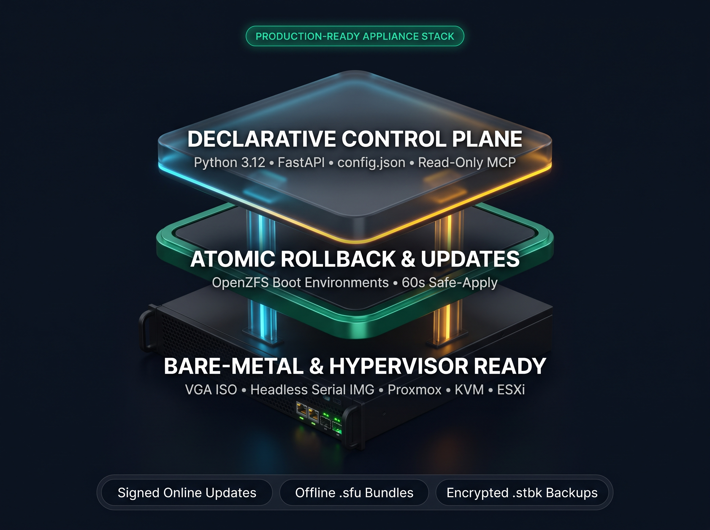

# Stratum Firewall — Official Bilingual Portal & Documentation

**Enterprise Network Security & Routing Appliance OS built on FreeBSD 15.1-RELEASE, Kernel `pf`, OpenZFS & FastAPI**

[[https://img.shields.io/badge/Website-stratumfw.com-f59e0b?style=for-the-badge]](https://stratumfw.com/)
[[https://img.shields.io/badge/Türkçe-stratumfw.com%2Ftr-0ea5e9?style=for-the-badge]](https://stratumfw.com/tr/)
[[https://img.shields.io/badge/Live_Demo-demo.stratumfw.com-10b981?style=for-the-badge]](https://demo.stratumfw.com)
[[https://img.shields.io/badge/Release-v0.34.1-6366f1?style=for-the-badge]](https://stratumfw.com/download/)

 

## Overview

This repository contains the bilingual (**English** & **Turkish**) Hugo source for [stratumfw.com](https://stratumfw.com/), covering architecture specifications, multi-vendor VPN documentation, OPNsense migration guides, release changelogs, technical blog articles, and offline installer verification pages.

| Main Appliance Showcase | Production Architecture Stack |
| :---: | :---: |
|  |  |

## Repository Structure

* `content/en/` & `content/tr/` — Bilingual product pages, comparison matrices, documentation, download metadata, and engineering blog posts with bidirectional `hreflang` linking.
* `layouts/` — Custom dark/light responsive Hugo templates, OpenGraph/Twitter card partials, and interactive gallery lightbox components.
* `static/` — Architectural diagrams, UI screenshots, and static assets.

## Quick Links

* **Interactive Read-Only Browser Demo:** [https://demo.stratumfw.com](https://demo.stratumfw.com)
* **Offline VGA `.iso` & Headless Serial `.img` Installers:** [https://stratumfw.com/download/](https://stratumfw.com/download/)
* **Official Changelog (`v0.1.0` – `v0.34.1`):** [https://stratumfw.com/resources/changelog/](https://stratumfw.com/resources/changelog/)
* **Main Appliance Documentation & Issue Tracker:** [kaanozkan-81/stratum-panel](https://github.com/kaanozkan-81/stratum-panel)

© 2026 Kaan Özkan. All rights reserved.
