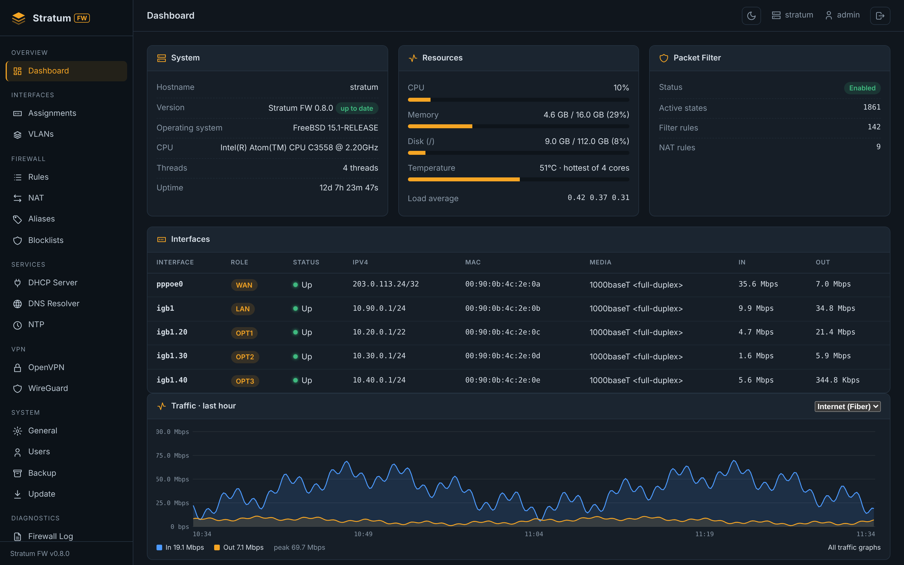
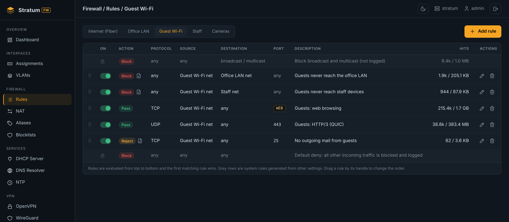
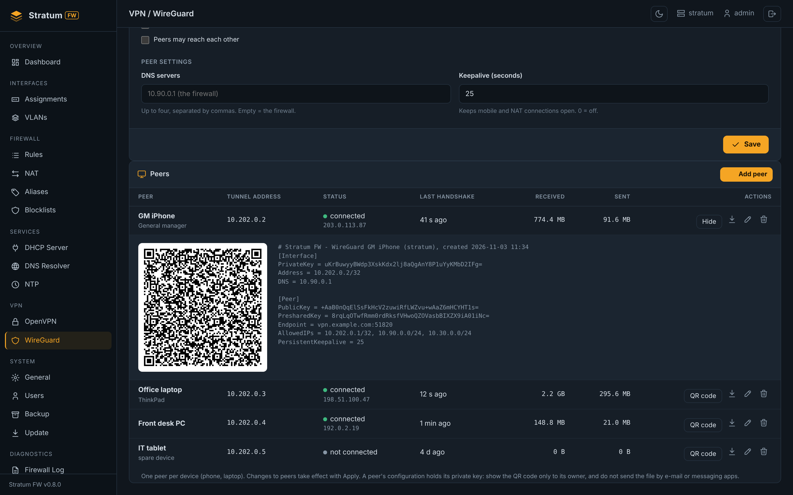

# Stratum Gateway

**Next-Generation Firewall OS built on FreeBSD.**

Stratum Gateway combines the FreeBSD kernel and the pf packet filter with a modern, lightweight FastAPI management panel. It is designed for engineers who demand transparency, raw performance, and modern manageability without the bloat of legacy appliances.

**Status:** Active Development (v0.8.0 Beta). 
Check out the [Releases](https://github.com/kaanozkan-81/stratumfw-site/releases) page to download the latest ISO.

---

## Interface Preview

*The main dashboard showing system vitals, pf packet filter states, and real-time interface traffic.*

  
  
  
<i>Declarative pf Rules and native WireGuard VPN management.</i>

---

## Core Philosophy

*   **Declarative Configuration:** You never edit complex firewall rules by hand. A single `config.json` is the source of truth. A Python engine translates this JSON into native FreeBSD files (`pf.conf`, `wg0.conf`).
*   **Safe-Apply Workflow:** Every change is validated using `pfctl -nf`. If a change cuts connectivity, the system automatically rolls back to prevent lockouts.
*   **API-First Architecture:** The web panel is just a client. Every configuration surface is exposed via a REST API, allowing for complete Infrastructure-as-Code (Ansible, Terraform).
*   **Zero Vendor Lock-in:** 100% open-source, self-hosted, and free from cloud dependencies. Your data never leaves your premises.

## Technology Stack

| Layer | Technology |
|---|---|
| **Operating System** | FreeBSD 14+ |
| **Packet Filter** | pf (Packet Filter) |
| **VPN** | WireGuard (Kernel-level, zero external dependencies) |
| **Backend** | Python 3.12 / FastAPI / Uvicorn |
| **Frontend** | Jinja2 / Vanilla JS / Industrial CSS |
| **Config Engine** | Python (generates `pf.conf`, `unbound.conf`) |

---

## Getting Started

### Download the Installer
Download the pre-built FreeBSD ISO from our website:
**[Download Stratum FW v0.8.0](https://stratumfw.com/download/)**

### Build from Source
To deploy the management panel on an existing FreeBSD 14 system, read the official guide:
**[Building from Source Guide](https://stratumfw.com/resources/documentation/building-from-source/)**

---

## Documentation

Comprehensive documentation is available on our website:

*   [Architecture Overview](https://stratumfw.com/product/architecture/)
*   [Installation & Initial Config](https://stratumfw.com/resources/documentation/)
*   [WireGuard VPN Setup](https://stratumfw.com/resources/documentation/wireguard-vpn/)
*   [pf & Firewall Rules](https://stratumfw.com/resources/documentation/pf-rules/)
*   [REST API Reference](https://stratumfw.com/resources/documentation/rest-api/)

---

## Contributing

We are actively building the platform in the open. Report bugs or request features via [Issues](https://github.com/kaanozkan-81/stratumfw-site/issues).

## License

The Stratum FW management panel and core engines are open-source. See the [LICENSE](LICENSE) file for details.
