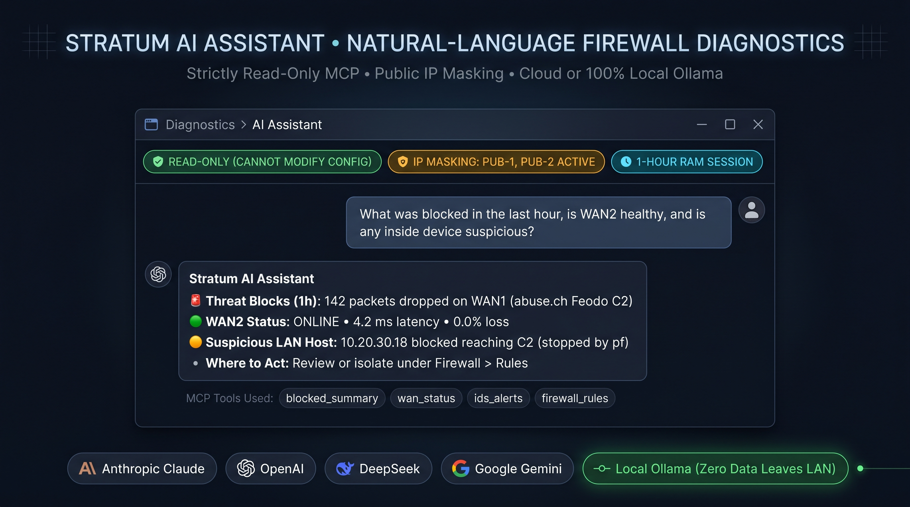
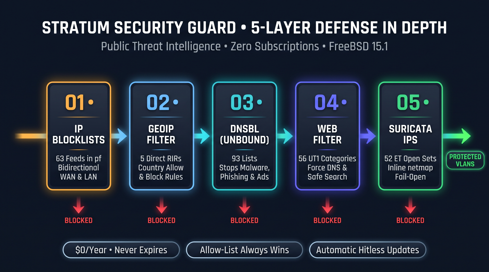

# Stratum Firewall — Official Bilingual Portal & Documentation

**Free, Subscription-Free Firewall & Routing Appliance OS on FreeBSD 15.1-RELEASE, Kernel `pf`, OpenZFS & FastAPI**

[[https://img.shields.io/badge/Website-stratumfw.com-f59e0b?style=for-the-badge]](https://stratumfw.com/)
[[https://img.shields.io/badge/Türkçe-stratumfw.com%2Ftr-0ea5e9?style=for-the-badge]](https://stratumfw.com/tr/)
[[https://img.shields.io/badge/AI_Assistant-Read--Only_MCP_%2B_Ollama-f59e0b?style=for-the-badge]](https://stratumfw.com/product/ai-assistant/)
[[https://img.shields.io/badge/Live_Demo-demo.stratumfw.com-38bdf8?style=for-the-badge]](https://demo.stratumfw.com)

 

## Built-In AI Diagnostics & 5-Layer Security Guard (`v0.35.1`)

| Built-In Read-Only AI Assistant (`MCP` + `Ollama`) | 5-Layer Security Guard (`$0/Year` Threat Defense) |
| :---: | :---: |
|  |  |

## Key Portal Pages

* **AI Assistant & MCP (`v0.35.1`):** [https://stratumfw.com/product/ai-assistant/](https://stratumfw.com/product/ai-assistant/)
* **Security Guard (5-Layer Threat Defense):** [https://stratumfw.com/product/security-guard/](https://stratumfw.com/product/security-guard/)
* **Security & Cryptographic Verification:** [https://stratumfw.com/product/security/](https://stratumfw.com/product/security/)
* **Interactive Browser Live Demo:** [https://demo.stratumfw.com](https://demo.stratumfw.com)
* **Offline VGA `.iso` & Serial `.img` Downloads:** [https://stratumfw.com/download/](https://stratumfw.com/download/)
* **Main Project Documentation & Issue Tracker:** [kaanozkan-81/stratum-panel](https://github.com/kaanozkan-81/stratum-panel)

© 2026 Kaan Özkan. All rights reserved.
